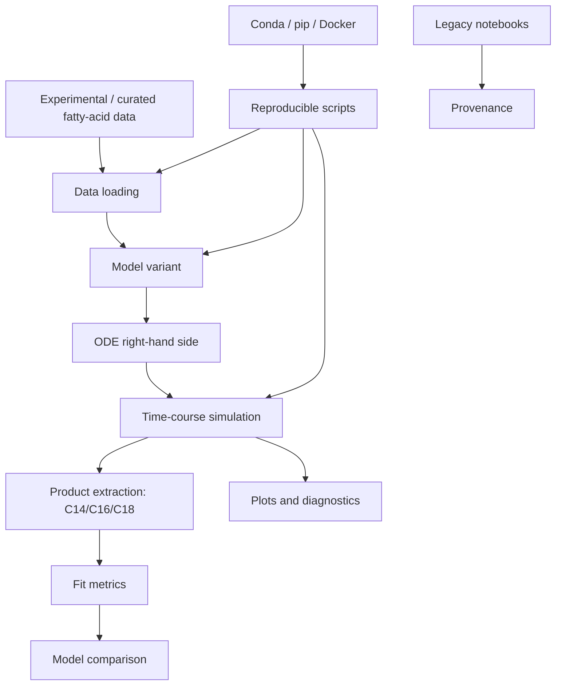

# Semi-mechanistic model of fatty acid de novo synthesis

Research code from my PhD project at Heinrich Heine University Düsseldorf, Institute for Quantitative and Theoretical Biology:

> Chilperic Armel Foko Kuate. *Dynamic computational modeling of fatty acid de novo synthesis in the liver and qualitative analysis of fatty acid metabolism*. PhD thesis, Heinrich Heine University Düsseldorf, 2023.

This repository organizes the semi-mechanistic fatty-acid de novo synthesis model used to study the elongation phase of fatty acid synthase and fit model variants to fatty-acid production data.

## Scientific purpose

The model focuses on fatty-acid de novo synthesis from acetyl-CoA, malonyl-CoA, and NADPH. The main products are C14:0, C16:0, and C18:0 fatty acids, with CoA release and enzyme-channeling assumptions represented in model variants.

## Model variants preserved from the PhD code

- basic model,
- CoA-inhibition model,
- CoA-inhibition with only C14/C16/C18 production,
- malonyl-CoA competition model,
- malonyl-CoA and acetyl-CoA competition model,
- model with release rate from distribution,
- open-system CoA-inhibition model,
- sinking-enzyme model,
- evaluation notebooks and scripts.

The cleaned, importable Python package is under `src/fadns_model/`. Sanitized legacy variant functions are under `src/fadns_model/legacy_variants/`. Original notebooks and scripts are preserved selectively under `models/` and documented in the manifest.

## Software architecture



## Repository structure

```text
fatty-acid-denovo-synthesis-model/
├── src/fadns_model/             # reusable package
│   └── legacy_variants/          # importable functions extracted from original model.py files
├── scripts/                      # runnable workflows
├── data/                         # small CSV datasets extracted from data.zip
├── models/                       # selected original model notebooks/scripts for provenance
├── tests/                        # lightweight checks
├── docs/                         # model notes and refactor audit
├── Dockerfile
├── environment.yml
├── pyproject.toml
└── README.md
```

## Quick start

```bash
python -m venv .venv
source .venv/bin/activate
pip install -e .[dev]
python scripts/01_list_variants.py
python scripts/02_load_data.py
python scripts/03_smoke_simulation.py
```

With Docker:

```bash
docker build -t fadns-model:latest .
docker run --rm fadns-model:latest
```

With Conda:

```bash
conda env create -f environment.yml
conda activate fadns-model
pip install -e .[dev]
```

## Reproducibility

This repository includes:

- package-style source code under `src/`,
- extracted CSV datasets under `data/`,
- executable scripts,
- Docker and Conda environments,
- lightweight tests,
- GitHub Actions smoke testing,
- preserved original model variants for provenance,
- a manifest of the original archive.

The original upload contained two identical FADNS archives. This refactor uses one canonical copy and records that duplication in `docs/refactor_audit.md`.

## Relation to thesis

This repository corresponds to the semi-mechanistic modelling part of the PhD thesis: fatty-acid synthase elongation, CoA release/inhibition, substrate dependence, model fitting, and model comparison.

## License and provenance

MIT license. Check original data-source and paper-source permissions before redistributing beyond this repository.
